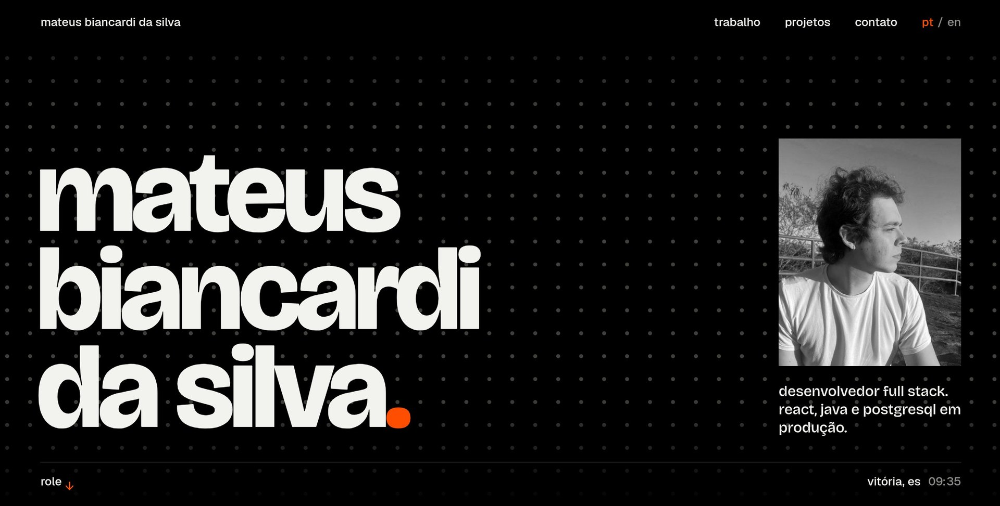

  
  
  

## Sobre

Desenvolvedor full stack na GAMA Ensino, em Vitória, ES. Faço software de educação em produção para mais de 24 mil usuários: do banco de dados à tela, passando por API, app mobile e IA.

Estudante de Ciência da Computação na UFES.

## O que faço hoje

- Construo a plataforma de simulados e redações do ENEM, com correção de redação por IA.
- Mantenho o app Android e iOS usado por 78 escolas de redes municipais.
- Coloco LLM em produto: mentor com IA no fórum, com registro de uso e painel de moderação.
- Escrevo ETLs em Python para o Data Warehouse que alimenta os painéis de BI.

## Números

| 24 mil+ | 78 | 16 | 3+ |
| :---: | :---: | :---: | :---: |
| usuários ativos | escolas no app mobile | instituições nos simulados | anos em produção |

## Stack

**Front-end**

     

**Back-end**

   

**Dados e infra**

   

**IA**

   

## Trajetória

| Quando | Onde | Papel |
| :--- | :--- | :--- |
| 2025 — hoje | GAMA Ensino | Desenvolvedor full stack |
| 2024 — 2025 | GAMA Ensino | Estágio em growth |
| 2022 — 2024 | CT Junior | Consultor de tecnologia, líder técnico em três projetos |

## Atividade

